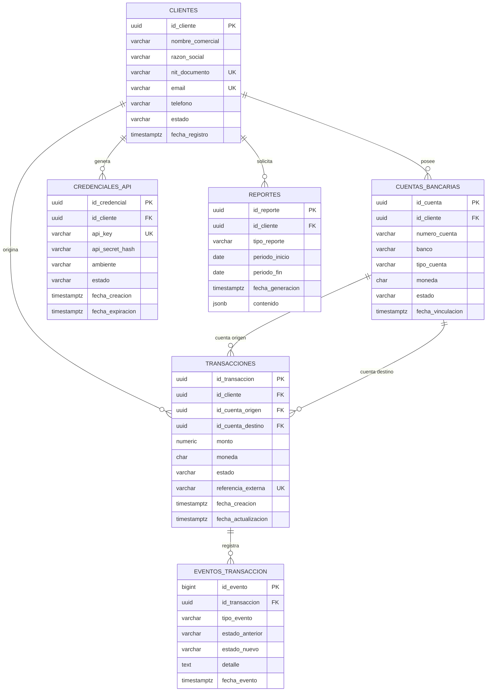
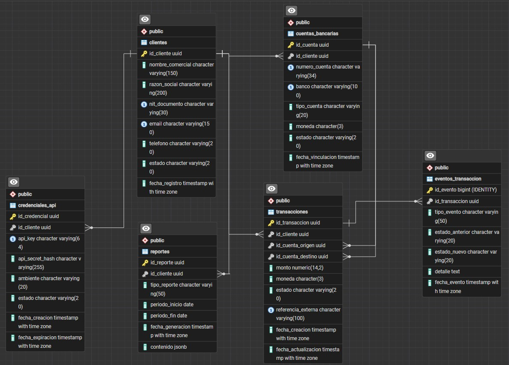
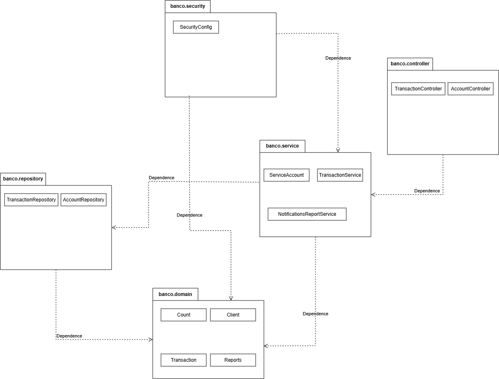
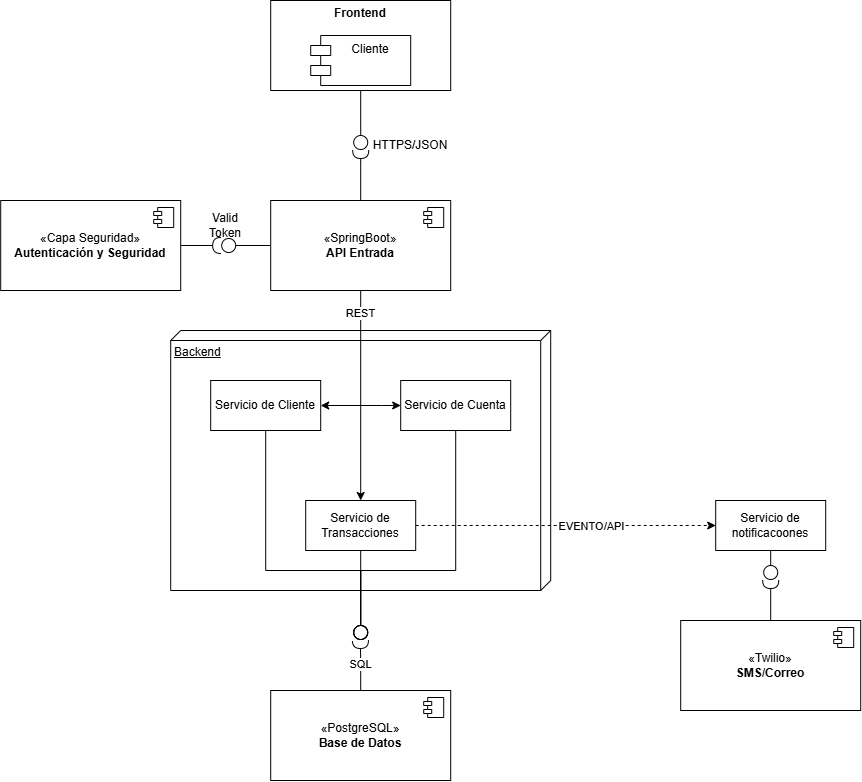
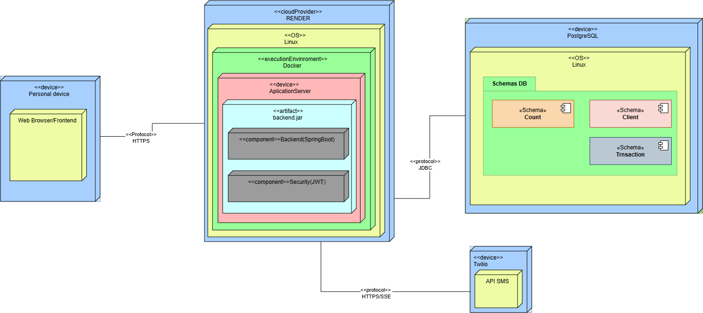

# ARQ-EAV08-2026-2

Repositorio de Arquitectura de Software del equipo avanzado 8, edición 26-2 de CodeF@ctory.

- YEPES JARAMILLO ANGEL SIMON: angel.yepes2@udea.edu.co
- CONTRERAS PUELLO SAMUEL ESTEBAN: samuel.contreras@udea.edu.co
- ALBORNOZ VILLADIEGO JOSÉ FERNANDO: jose.albornoz@udea.edu.co

# Sprint 1

## Contexto de negocio

Las regulaciones de open banking impulsan la apertura de los sistemas financieros para que terceros desarrollen nuevos servicios a partir de información bancaria, siempre con el consentimiento del usuario. Para habilitar este ecosistema, las instituciones financieras deben ofrecer APIs que permitan a aplicaciones externas consultar información y ejecutar ciertas operaciones de forma controlada.

## Problema a resolver

BackendBank busca ser la capa tecnológica que expone servicios bancarios mediante APIs seguras, permitiendo que aplicaciones externas interactúen con ellos bajo reglas claras de acceso y trazabilidad.

## Alcance funcional

- **Registro de aplicaciones externas**.
- **Gestión de credenciales y autenticación**.
- **Exposición de APIs**.
- **Control de permisos y consentimiento**.
- **Registro de solicitudes**.
- **Reportes**.

## Estado al cierre del sprint 1

El módulo implementado es la **gestión de clientes**, base para el resto de la plataforma:

- Registro de clientes (`POST /clientes`)
- Ingreso con validación de credenciales y estado (`POST /clientes/ingreso`)
- Actualización de datos por un administrador (`PUT /clientes/{id}`)
- Cambio de estado activo/inactivo por un administrador (`PATCH /clientes/{id}/estado`)

Incluye roles (`CLIENTE`, `ADMINISTRADOR`) y estados (`activo`, `inactivo`, `bloqueado`, `pendiente_de_validacion`).

Historias comprometidas en el sprint 1:

- Registrar un nuevo cliente
- Actualizar datos del perfil de un cliente
- Cambiar el estado de un cliente (activo/inactivo)
- Autenticarse en el sistema
- Restringir acciones según el rol del usuario

La review dejó el manejo de las contraseñas de los clientes para corregirlo en el sprint 2.

Video del backend y de cómo las ejecuciones se reflejan en la base de datos: https://drive.google.com/file/d/1mA1mIw5pobcbCp0FEJ88T2emUkaHuXbK/view?usp=sharing

Al cerrar el sprint 1 quedó previsto:

- Definir las historias de usuario del sprint 2 en la planning.
- Corregir el manejo de las contraseñas, recomendación de la review.
- Aplicar, si el tiempo alcanzaba, las enseñanzas vistas a lo largo del semestre.

## Modelo lógico





## Diagrama de paquetes



## Diagrama de componentes



## Criterio 4. Modelo físico

El modelo físico está en [`base de datos/schema.sql`](./base%20de%20datos/schema.sql). La aplicación aplica el mismo script desde `src/main/resources/db/schema.sql`.

## ADRs

### ADR-001: Monolito en capas con servicios separados por responsabilidad

**Estado:** Aceptado

**Contexto:** BackendBank debe exponer APIs bancarias. En el sprint 1 solo existe la gestión de clientes. Se buscó el mismo modelo de capas y servicios que se usa ahora, con el servicio apartado del controlador y de la persistencia, pero desplegado dentro de un solo proceso.

**Decisión:** Una sola aplicación Spring Boot (`backendbank`) y una sola base PostgreSQL. El módulo `cliente` queda en tres capas:

- API: `ClienteController`, los records de request/response y `ApiExceptionHandler`
- Servicio: `ClienteService`
- Persistencia: `Cliente` y `ClienteRepository`

El controlador no accede a la base. Llama al servicio, y el servicio llama al repositorio.

**Consecuencias:** El despliegue es un solo artefacto y las operaciones de un caso de uso quedan en una transacción. El servicio puede extraerse después sin reescribir las reglas. El riesgo es que `ClienteService` concentre demasiado cuando entren credenciales, permisos y reportes.

### ADR-002: PostgreSQL con JPA y esquema fuera de la aplicación

**Estado:** Aceptado

**Contexto:** Los clientes, sus credenciales y su estado tienen que persistir con unicidad de documento, email y usuario. El esquema no debe cambiar solo porque arranque la aplicación.

**Decisión:** Spring Data JPA contra PostgreSQL. En `application.properties`, `spring.jpa.hibernate.ddl-auto=none` y `spring.jpa.open-in-view=false`. La entidad `Cliente` mapea la tabla `clientes`. El id es un UUID asignado en `@PrePersist`. La unicidad se valida en `ClienteService` y, si la base rechaza el insert, `DataIntegrityViolationException` se traduce a `ClienteDuplicadoException`. Los tests usan H2.

**Consecuencias:** El esquema se controla aparte del código y Hibernate no genera DDL en runtime. Cada request no mantiene una sesión JPA abierta. Hay dos chequeos de duplicado (servicio y restricción de la base) para cubrir la condición de carrera.

### ADR-003: Autorización por rol en el servicio y errores de dominio en el borde HTTP

**Estado:** Aceptado

**Contexto:** Actualizar un cliente y cambiar su estado son acciones de administrador. El ingreso depende del estado de la cuenta. En este sprint no hay un servidor de identidad aparte.

**Decisión:** La identidad del actor viaja como el UUID `actualizadoPor`. `ClienteService.exigirAdministrador` exige que ese cliente exista, esté `activo` y tenga rol `ADMINISTRADOR`. Quien se registra queda con rol `CLIENTE` y estado `activo`. Las reglas de negocio lanzan excepciones de dominio (`AccesoDenegadoException`, `ClienteDuplicadoException`, `CredencialesInvalidasException`, entre otras) y `ApiExceptionHandler` las convierte en 400, 401, 403, 404 o 409. Los datos de entrada se validan con Jakarta Validation en el controlador.

**Consecuencias:** Las reglas de acceso quedan junto al caso de uso y la API responde siempre con el mismo formato de error. No hay token ni sesión: quien conozca el UUID de un administrador puede ejecutar la acción. La contraseña se guarda y se compara en texto plano; la review del sprint 1 dejó eso para corregirlo en el sprint 2.

# Sprint 2

En el sprint 1 quedó el módulo de clientes, el modelo y las decisiones de arquitectura. Este sprint muestra cómo ese backend se entrega y se consume.

El diagrama de despliegue dice dónde corre la aplicación y con qué se conecta. Las APIs priorizadas dicen qué se expone primero para un tercero de open banking. Hay ocho APIs REST; las tres de mayor prioridad cubren el mínimo pedido. La documentación de más abajo permite llamarlas sin leer el código. GitHub Actions compila y prueba en cada cambio. El análisis de Sonar que se puede mostrar es el del proyecto `backendbank` en la organización EAV08: este repositorio no es de esa cuenta, así que no puede publicar otro. OWASP Top Ten registra los riesgos de esta API. Sonar marca hallazgos automáticos de código y no sustituye esa identificación.

La recomendación de la review sobre las contraseñas quedó atendida: el registro guarda la clave con BCrypt.

## Diagrama de despliegue

BackendBank sigue siendo un solo proceso. No hay un servicio por cada API. Spring Boot atiende todas las rutas, PostgreSQL guarda clientes y cuentas, y el `Dockerfile` produce la imagen que se despliega. El contenedor abre el puerto 8080. La conexión a la base, el puerto y el secreto del token no van fijos en la imagen: entran por `PORT`, `DB_URL`, `DB_USERNAME`, `DB_PASSWORD` y `JWT_SECRET`. Así el mismo artefacto sirve en local y en el entorno desplegado.



## APIs priorizadas

Un tercero no necesita las ocho operaciones al mismo tiempo. Primero tiene que saber quién es el cliente, después leer la cuenta y solo entonces modificar algo. Por eso el orden es autenticar, consultar y operar. Must es lo que este sprint tiene que dejar usable. Should completa el alta y el bloqueo. Could queda para la administración interna del perfil, que ya venía del sprint 1.

| Prioridad | API | Para qué |
| --- | --- | --- |
| Must | `POST /clientes/ingreso` | Identifica al cliente y entrega el token de sesión. |
| Must | `POST /cuentas/saldo` | Consulta el saldo disponible, el dato principal para un tercero. |
| Must | `POST /cuentas/estado` | Informa si la cuenta está activa, inactiva o bloqueada antes de operar. |
| Should | `POST /cuentas` | Abre una cuenta financiera del cliente. |
| Should | `POST /cuentas/bloqueo` | Bloquea la cuenta por pérdida o fraude. |
| Should | `POST /clientes` | Registra al cliente que va a consumir el resto de servicios. |
| Could | `PUT /clientes/{id}` | Actualiza el perfil. Solo un administrador. |
| Could | `PATCH /clientes/{id}/estado` | Activa o inactiva el perfil. Solo un administrador. |

Las tres marcadas como Must cubren el mínimo del sprint. Las ocho están implementadas.

## Documentación de las APIs

Todas responden JSON bajo `http://localhost:8080`. Un dato inválido responde `400` con `mensaje` y la lista `errores` (`campo`, `mensaje`). Las marcadas como Must en la tabla anterior son `POST /clientes/ingreso`, `POST /cuentas/saldo` y `POST /cuentas/estado`. Aquí queda el contrato de las ocho, en el orden en que se usan: primero el cliente y después la cuenta.

### POST /clientes

Registra un cliente con rol `CLIENTE` y estado `activo`. La contraseña se guarda con BCrypt.

```json
{
  "nombreComercial": "Comercio Norte",
  "razonSocial": "Comercio Norte SAS",
  "nitDocumento": "900123456",
  "email": "norte@example.com",
  "usuario": "norte",
  "contrasena": "clave-segura",
  "telefono": "3001234567"
}
```

`telefono` es opcional. Respuesta `201`: `idCliente`, `estado`, `mensaje`. Si el documento, el email o el usuario ya existen, responde `409`.

### POST /clientes/ingreso

Valida usuario y contraseña. Tras varios intentos fallidos el perfil queda bloqueado de forma temporal.

```json
{
  "usuario": "norte",
  "contrasena": "clave-segura"
}
```

Respuesta `200`: `idCliente`, `estado`, `mensaje`, `token`. Credenciales incorrectas: `401`. Perfil inactivo, bloqueado o pendiente: `403`. Bloqueo temporal vigente: `423`.

### PUT /clientes/{id}

Actualiza nombre comercial, razón social, email y teléfono. El cuerpo incluye `actualizadoPor` con el UUID de un administrador activo.

Respuesta `200` con los datos guardados. Sin un administrador vigente: `401`. Quien no es administrador: `403`. Cliente inexistente: `404`. Email repetido: `409`.

### PATCH /clientes/{id}/estado

Cambia el estado entre `activo` e `inactivo`. El cuerpo lleva `estado`, `motivo` y `actualizadoPor`.

Respuesta `200`: `idCliente`, `estado`, `motivo`, `mensaje`. La misma transición no permitida responde `409`. Los códigos de sesión son los de la actualización.

### POST /cuentas

Abre una cuenta en ceros para un cliente habilitado. Máximo tres cuentas activas. El número lo genera el sistema.

```json
{ "idCliente": "uuid-del-cliente" }
```

Respuesta `201`: `idCuenta`, `numeroCuenta`, `idCliente`, `estado`, `saldo`, `mensaje`. Perfil bloqueado, inactivo o con el máximo de cuentas: `403`. Cliente inexistente: `404`. Fallo al reservar el número: `503`.

### POST /cuentas/saldo

```json
{
  "idCliente": "uuid-del-cliente",
  "idCuenta": "uuid-de-la-cuenta"
}
```

Respuesta `200` con el saldo. Cuenta bloqueada o inactiva: `403`. Cuenta de otro cliente o inexistente: `404`. Saldo no disponible: `503`.

### POST /cuentas/bloqueo

Bloquea una cuenta activa. `motivo` acepta `pérdida`, `perdida` o `fraude`.

```json
{
  "idCliente": "uuid-del-cliente",
  "idCuenta": "uuid-de-la-cuenta",
  "motivo": "fraude"
}
```

Respuesta `200`: estado `bloqueado`, `operacionesSuspendidas` y el motivo. Si ya estaba bloqueada, responde `200` e informa que el bloqueo ya existía. Cuenta inactiva: `403`.

### POST /cuentas/estado

Consulta el estado con usuario, contraseña y número de cuenta.

```json
{
  "usuario": "norte",
  "contrasena": "clave-segura",
  "numeroCuenta": "0001234567"
}
```

Respuesta `200`: `numeroCuenta`, `estado`, `mensaje`. Contraseña incorrecta: `401`. Usuario o cuenta inexistente: `404`.

## CI/CD con GitHub Actions

El workflow [`.github/workflows/ci.yml`](.github/workflows/ci.yml) corre en cada push y en cada pull request. Comprueba el código. No despliega la aplicación: el despliegue queda descrito en el diagrama y en el `Dockerfile`.

1. **CI.** Instala Java 17, ejecuta `./mvnw verify` y genera el informe JaCoCo. Sube el artefacto `reportes-ci` aunque alguna prueba falle.
2. **Análisis Sonar.** Intenta enviar el informe a SonarCloud. Publicar en la organización EAV08 exige el token de esa cuenta, y esta copia del repositorio no lo tiene.
3. **Cobertura JaCoCo.** Comprueba `jacoco.xml` e `index.html` y publica el artefacto `cobertura-jacoco`.

Las pruebas usan H2 en memoria, así que el runner no necesita PostgreSQL.

## Sonar

El análisis visible está en SonarQube Cloud, organización **EAV08**, proyecto **backendbank**, clave `EAV08_BackendBank`. Es público, tiene 1.6k líneas y el último análisis es del 24 de octubre de 2026. Se abre sin pertenecer a la organización:

https://sonarcloud.io/project/overview?id=EAV08_BackendBank

Conectar otro Sonar desde este repositorio no es posible: la copia no administra el token de EAV08. Para ver el informe basta con ese enlace. No hace falta copiar el tablero completo en este README ni pedir acceso a la organización.

En ese análisis el quality gate está en **Passed**. Hay 14 issues, 0,0 % de duplicación y 86,7 % de cobertura. Seguridad está en A, con 2 issues de severidad Blocker y 0 security hotspots. Confiabilidad está en A, con 9 issues (la mayoría Info y una parte Medium). Mantenibilidad está en A, con 11 issues. El tablero también muestra 2 advertencias del análisis.

Esos números son la evidencia del sprint 2. Corregirlos queda para el sprint 3, porque hace falta poder publicar de nuevo en ese proyecto. La identificación OWASP de la sección siguiente se hizo leyendo el código. Un issue de Sonar no reemplaza esa lectura.

## Identificación de vulnerabilidades (OWASP Top Ten 2021)

| Riesgo | Hallazgo en BackendBank | Impacto |
| --- | --- | --- |
| A01 Pérdida de control de acceso | El ingreso emite un token, pero crear cuenta, consultar saldo, bloquear y administrar clientes no lo exigen. La autorización usa el UUID que llega en el cuerpo (`idCliente` o `actualizadoPor`). | Quien conozca el UUID de un administrador cambia perfiles y estados. Quien conozca el UUID de un cliente abre cuentas, consulta saldos o bloquea. |
| A02 Fallos criptográficos | `application.properties` trae secreto JWT y clave de PostgreSQL por defecto. El ingreso todavía acepta una contraseña guardada en texto plano y solo entonces la pasa a BCrypt. | Con el secreto por defecto se puede firmar un token válido. Una base migrada a medias sigue comparando claves en claro. |
| A03 Inyección | Las consultas pasan por Spring Data JPA. No hay SQL armado con datos del cliente. La validación de entrada está en el controlador. | Sin hallazgo de inyección en el código actual. |
| A04 Diseño inseguro | `POST /cuentas/estado` pide usuario y contraseña en cada consulta, en lugar del token ya emitido. El modelo trata un UUID enviado por el cliente como si fuera una sesión. | La contraseña viaja más de lo necesario y la identidad no queda atada a la prueba de ingreso. |
| A05 Configuración de seguridad incorrecta | No hay cadena de filtros que exija autenticación. DevTools está en el runtime. El esquema SQL se aplica en cada arranque. | Cualquier cliente HTTP llega a los endpoints. Un perfil de desarrollo no debería ir al entorno desplegado. |
| A06 Componentes vulnerables y desactualizados | El pipeline no ejecuta un análisis de dependencias. La base es Spring Boot 4.1.1 y Java 17. | No se afirma un CVE concreto. Falta el chequeo de librerías para sostener que están limpias. |
| A07 Fallos de identificación y autenticación | El token se firma con HMAC-SHA256 y vence, pero el resto de la API no llama a `TokenService.validar`. En `POST /cuentas/estado` un usuario inexistente y una contraseña incorrecta responden distinto. El ingreso sí unifica el mensaje y bloquea tras intentos fallidos. | Hay suplantación por UUID y enumeración de usuarios en la consulta de estado. El ingreso está mejor cerrado. |
| A08 Fallos de integridad de software y datos | GitHub Actions compila y prueba. No firma el jar ni verifica la integridad de las dependencias más allá de lo que resuelve Maven. | Un artefacto alterado entre el build y el despliegue no se detecta en este pipeline. |
| A09 Fallos de registro y monitoreo | Los cambios de estado y los accesos denegados no quedan en una bitácora de seguridad. Solo se persiste el motivo en la fila. | Un abuso de los UUID o un bloqueo repetido no genera alerta. |
| A10 SSRF | Ningún endpoint pide una URL ni llama a un host elegido por el cliente. La consulta de saldo lee el valor de la propia cuenta. | No aplica al código actual. |

Lo que ya mitiga parte de A02 y A07: BCrypt en el registro, el mismo mensaje de credenciales inválidas en el ingreso, el bloqueo temporal y la firma del token. El hueco que sigue abierto es no usar ese token como prueba de identidad en el resto de operaciones.

# Sprint 3

Todavía no hay planning. Lo que sigue es la intención del sprint, no un compromiso cerrado de historias.

- Corregir bugs que el Sonar de EAV08 ya muestra en `backendbank`. El punto de partida son los 2 issues de seguridad en severidad Blocker, y después los de confiabilidad y mantenibilidad. Cada corrección se demuestra volviendo a mirar ese análisis.
- Definir en la planning 3 o 4 historias de usuario. Aún no están escritas.
- Intentar un frontend hecho con IA para el demo, de modo que las APIs de este backend se puedan mostrar desde una pantalla y no solo con peticiones sueltas.
